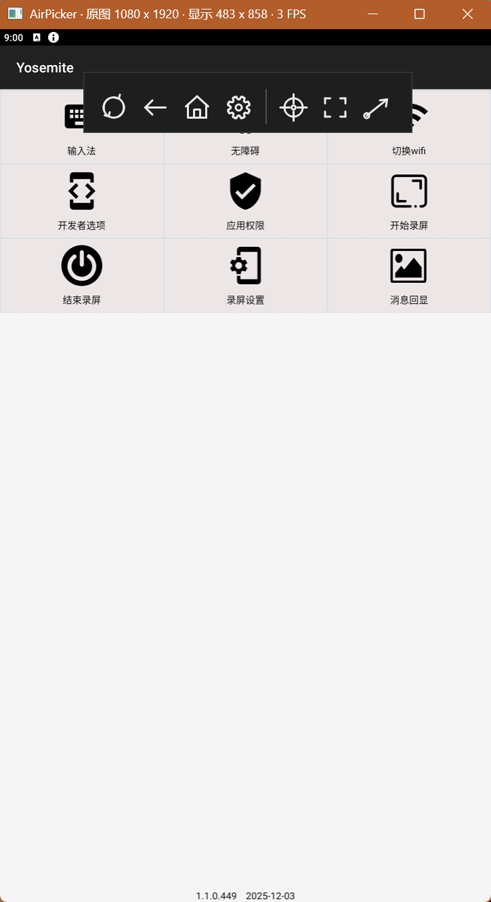

# AirPicker

> 从 Android 实时屏幕框选按钮 / 图标，自动生成 Airtest 模板代码并复制到剪贴板的桌面小工具。
>
> **项目起点：** 在 **PyCharm + Airtest** 的开发模式下，用本工具取代 AirtestIDE 完成截图取码，形成完整的 Airtest 脚本开发闭环——不依赖 AirtestIDE，不写 PyCharm 插件，一个独立 Python 程序即可。



---

## 目录

- [项目背景](#项目背景)
- [核心特性](#核心特性)
- [安装](#安装)
- [部署与启动](#部署与启动)
- [使用指南](#使用指南)
- [Airtest 脚本开发工作流](#airtest-脚本开发工作流)
- [配置参考](#配置参考)
- [故障排查](#故障排查)
- [项目结构](#项目结构)
- [开发](#开发)
- [许可证](#许可证)

---

## 项目背景

在 **Airtest + PyCharm** 模式下编写自动化脚本时，经常需要从 Android 实时屏幕里截取按钮、图标或文字区域，并生成 Airtest 可用的代码：

```python
touch(Template(r"../pics/tpl_login.png"))
```

传统做法是打开 AirtestIDE 截图、框选、复制代码，再切回 PyCharm 粘贴。如果希望**整个过程都留在 PyCharm 开发流里**，就需要一个独立的小工具。

AirPicker 就是为此设计的，核心闭环：

```text
运行 AirPicker
  → 连接 Android 设备并实时投屏
  → 鼠标框选目标区域
  → 保存原图分辨率的模板图片
  → 自动生成 Airtest Template / touch / swipe 代码
  → 复制到剪贴板
  → 在 PyCharm 的脚本中 Ctrl+V 粘贴
```

它解决的是「取码」这一环，让你无需在 IDE 之间来回切换。

---

## 核心特性

- **实时投屏**：基于 Airtest 的 `MINICAP + MINITOUCH`，默认 30 FPS，窗口缩放不影响裁剪精度（按原图分辨率保存）。
- **鼠标模拟设备操作**：默认模式下，单击 = 点击设备，拖拽 = 滑动设备，坐标按设备原图换算。
- **框选模板**：拖拽框选 → 保存 `pics/tpl_时间戳.png` → 生成 `Template(...)` 并复制到剪贴板。
- **取点 / 滑动取码**：单击获取坐标、拖拽生成 `swipe(...)`，回写表达式完全可配置。
- **设备按键**：悬浮工具栏提供返回、主页按钮，直接向设备下发按键。
- **悬浮工具栏**：黑色面板 + 白色线性图标，可拖拽、可横竖切换，带悬停 / 按下 / 刷新旋转动画。
- **连接自愈**：ADB 连接失败时自动强制结束 `adb.exe` 并重启 ADB Server 重试一次。
- **设置持久化**：工具栏方向、资源 / 项目目录、回写表达式、窗口大小等保存在 `settings.json`。


---

## 安装

### 环境要求

| 项目 | 要求 |
| --- | --- |
| 操作系统 | Windows（剪贴板功能依赖系统） |
| Python | >= 3.10 |
| 包管理 | [uv](https://docs.astral.sh/uv/)（推荐） |
| Android 设备 | 开启 USB 调试，并已通过 `adb devices` 验证 |

依赖清单见 `pyproject.toml`：

- `airtest>=1.3`
- `opencv-python>=4.8`
- `pillow>=10`
- `pyperclip>=1.9`
- `pyside6>=6.12.0`

### 1. 安装 uv

```powershell
powershell -ExecutionPolicy ByPass -c "irm https://astral.sh/uv/install.ps1 | iex"
```

其他平台见 [uv 官方安装文档](https://docs.astral.sh/uv/getting-started/installation/)。

### 2. 获取源码并安装依赖

```bash
git clone https://github.com/Qr1mln/AirPicker.git AirPicker
cd AirPicker
uv sync
```

`uv sync` 会按 `uv.lock` 创建 `.venv` 并安装全部依赖。

> 不使用 uv 也可以：`python -m venv .venv` 后 `pip install -r requirements.txt`。
> 注意 `requirements.txt` 未锁定 PySide6，建议使用 uv 以获得可复现环境。

### 3. 设备端准备

1. 手机开启「开发者选项」→「USB 调试」。
2. 用 USB 连接电脑，授权调试。
3. 验证设备可见：

```bash
adb devices
```

输出中应出现设备序列号且状态为 `device`（不是 `unauthorized` / `offline`）。

多设备时，在 `airpicker/config.py` 里把 `SERIAL` 设为目标序列号。

### 4. 验证安装

```bash
uv run python -c "import airtest, cv2, PySide6, pyperclip; print('依赖 OK')"
```

---

## 部署与启动

AirPicker 是本地桌面工具，无需服务端部署，「部署」即完成上面的环境安装与设备连接后启动程序。

### 方式一：命令行启动

```bash
uv run python -m airpicker
```

### 方式二：PyCharm 启动（期初推荐）

这正是本项目最初的使用方式：

1. 用 PyCharm 打开项目根目录。
2. 将项目解释器设置为 `.venv/Scripts/python.exe`（`Settings → Project → Python Interpreter → Add Interpreter → Existing`）。
3. 右键项目根目录的 `main.py` → `Run 'main'`。

`main.py` 只是把项目根目录加入 `sys.path` 后调用 `airpicker.__main__.main()`，等价于命令行的 `python -m airpicker`。

启动成功后控制台会输出：

```text
[信息] 正在连接设备：...
[信息] 设备屏幕：1080 x 2400
[信息] 设备连接成功（MINICAP）
[信息] 默认模式：单击=点击设备，拖拽=滑动设备；工具栏可切换框选 / 取点
```

随后弹出实时投屏窗口，右上角（或上方）为可拖拽的悬浮工具栏。

### 可选：打包为独立 exe

项目当前以源码方式运行。若需脱离 Python 环境分发，可用 PyInstaller 自行打包（需额外安装）：

```powershell
uv pip install pyinstaller
uv run pyinstaller --noconfirm --onefile --windowed main.py -n AirPicker
```

生成物在 `dist/AirPicker.exe`。首次打包建议保留 `--console` 便于查看连接日志，调试通过后再改为 `--windowed`。

---

## 使用指南

### 界面与工具栏

窗口主体是 Android 实时画面，悬浮工具栏包含 7 个按钮：

| 按钮 | 作用 |
| --- | --- |
| 强制刷新（双弧循环箭头） | 视觉反馈动画（图标旋转 360°），不执行设备操作 |
| 返回（左箭头） | 向设备下发返回键 |
| 主页（房子） | 向设备下发 Home 键 |
| 设置（齿轮） | 打开设置弹窗 |
| 四角框 | 进入框选模板模式 |
| 准星 | 进入取点模式 |
| 斜向箭头 | 进入滑动取码模式 |

工具栏可用鼠标拖拽移动，方向在设置中切换横 / 竖。

### 默认模式：鼠标模拟触控

启动后即处于默认模式：

- **左键单击** → 向设备发送点击；
- **左键按住拖拽** → 向设备发送滑动。

坐标按设备原图分辨率换算，窗口缩放不影响准确性。

### 框选模板

1. 点击工具栏「四角框」进入框选模式（标题栏会提示）。
2. 在画面上按住左键拖拽出目标区域。
3. 松开鼠标后自动完成：
   - 原图分辨率裁剪结果保存到资源目录（默认 `pics/tpl_时间戳.png`）；
   - 控制台打印 `Template(...)` 与 `touch(Template(...))`；
   - 代码复制到剪贴板；
   - 自动回到默认模式。
4. 框选过程中按**右键**取消。

生成内容由「模板回写表达式」决定，默认：

```python
Template(r"{path}", record_pos=({rx}, {ry}), resolution=({rw}, {rh}))
```

### 获取坐标

1. 点击「准星」进入取点模式，此时触控 / 滑动**失效**。
2. 单击画面 → 复制坐标并自动回到默认模式。
3. 右键取消。

默认格式为 `({x}, {y})`，可在设置中改为 `[{x},{y}]` 等任意组合。

### 滑动取码

1. 点击「斜向箭头」进入滑动模式，此时触控 / 滑动**失效**。
2. 从起点拖拽到终点，松开后生成 `swipe(...)` 代码并复制，自动回到默认模式。
3. 右键取消。

默认格式为 `swipe(({x1}, {y1}), ({x2}, {y2}))`。

### 设置弹窗

点击齿轮按钮打开，可配置：

| 设置项 | 说明 |
| --- | --- |
| 工具栏横 / 竖 | 布局方向 |
| 资源目录 | 模板图片保存目录，默认项目 `pics/` |
| 项目目录 | 生成模板相对路径的基准目录，默认项目 `scripts/` |
| 坐标回写表达式 | 变量 `{x}` `{y}` |
| 模板回写表达式 | 变量 `{path}` `{name}` `{rx}` `{ry}` `{rw}` `{rh}` |
| 滑动回写表达式 | 变量 `{x1}` `{y1}` `{x2}` `{y2}` |
| 锁定画面比例 | 缩放窗口时是否按设备比例联动宽高 |
| 窗口大小 | 自动记忆，下次启动恢复 |

所有设置保存到项目根目录 `settings.json`，文件缺失或损坏时自动回退默认值。

---

## Airtest 脚本开发工作流

这是项目期初确立、也是推荐的开发方式：

**第 1 步：启动 AirPicker**

按上文「方式二：PyCharm 启动」运行 `main.py`，确认实时投屏正常。

**第 2 步：在设备上打开目标页面**

例如 App 的登录页，让按钮出现在投屏画面中。

**第 3 步：框选目标，自动生成代码**

点击工具栏「四角框」，框选登录按钮，松开后代码已进入剪贴板：

```python
Template(r"../pics/tpl_20250101_123456_789.png", record_pos=(0.12, -0.34), resolution=(1080, 2400))
```

**第 4 步：在 PyCharm 中粘贴**

切回 PyCharm，在你的 Airtest 测试脚本中 `Ctrl+V`（脚本可放在任意位置，例如工程根目录的 `test_case.py`）：

```python
from airtest.core.api import *

connect_device("Android:///")
touch(Template(r"../pics/tpl_20250101_123456_789.png", record_pos=(0.12, -0.34), resolution=(1080, 2400)))
assert_exists(Template(r"../pics/tpl_success.png", record_pos=(0.0, 0.2), resolution=(1080, 2400)))
```

**第 5 步：运行脚本验证**

直接在 PyCharm 中运行该脚本，Airtest 会连接设备并执行点击 / 断言。

**第 6 步：迭代**

识别失败时，回到 AirPicker 重新框选一张更清晰的模板（避免背景干扰、尽量贴近按钮边缘），粘贴替换即可。

> 若模板路径与脚本不在同一目录，先在设置里把「项目目录」指向你的 Airtest 工程根目录，生成的相对路径就会以它为基准。

---

## 配置参考

### `airpicker/config.py`

适合修改后重启生效的底层参数：

| 常量 | 说明 | 默认值 |
| --- | --- | --- |
| `SERIAL` | 多设备时指定序列号，留空用默认设备 | `""` |
| `DEVICE_URI` | Airtest 连接串 | `Android:///?cap_method=MINICAP&touch_method=MINITOUCH` |
| `MINICAP_QUALITY` | MINICAP 画质（1~100） | `100` |
| `MAX_W` / `MAX_H` | 窗口最大宽高 | `1280` / `1200` |
| `DISPLAY_SHARPEN` | 显示锐化 | `True` |
| `FPS` | 投屏帧率 | `30` |
| `COPY_MODE` | `template` 生成 `Template(...)`；`touch` 生成 `touch(Template(...))` | `"template"` |
| `MIN_SELECT` | 框选最小尺寸（像素） | `4` |
| `TAP_SLOP` | 鼠标位移小于该值视为点击，否则视为滑动 | `6` |
| `SWIPE_DURATION` | 模拟滑动持续时间（秒） | `0.3` |

### 回写表达式变量

| 表达式 | 可用变量 |
| --- | --- |
| 坐标 | `{x}` `{y}` |
| 模板 | `{path}`（相对项目目录） `{name}`（文件名） `{rx}` `{ry}`（记录位置） `{rw}` `{rh}`（分辨率） |
| 滑动 | `{x1}` `{y1}` `{x2}` `{y2}` |

---

## 故障排查

### `ADB devices not found` / 连接失败

程序会先打印首次失败原因，然后**自动强制结束所有 `adb.exe`、重启 ADB Server 并重试一次**：

```text
[警告] 首次连接失败：ADB devices not found
[信息] 正在强制结束 adb.exe 并重新连接...
[信息] 强制重启 adb 后连接成功
```

仍失败时请检查：

1. USB 调试是否开启、弹窗是否点了「允许」；
2. `adb devices` 能否看到设备；
3. 是否有其他工具占用 ADB（重启会结束所有 `adb.exe`，包括 AirtestIDE 的）；
4. 设备是否离线，尝试重新插拔 USB。

### MINICAP 不可用

连接或取帧失败时，控制台会提示改用 JAVACAP：

```text
Android:///?cap_method=JAVACAP&touch_method=MINITOUCH
```

把 `config.py` 的 `DEVICE_URI` 改为上述字符串后重启。多设备时保留 `127.0.0.1:5037/序列号` 部分，只替换 `cap_method`。

### 模板路径不对

生成的相对路径以「项目目录」为基准。若粘贴到 Airtest 工程后提示找不到图片，检查设置里的「项目目录」是否指向该工程根目录，以及「资源目录」中的图片是否确实存在。

### 窗口画面卡顿

把 `config.py` 的 `FPS` 降到 20；确认 `DISPLAY_SHARPEN` 是否必要。

### 剪贴板失败

`pyperclip` 异常时，代码仍会打印在控制台，可手动复制。

---

## 项目结构

```text
AirPicker/
├── main.py                             PyCharm 入口
├── settings.json                       界面与路径设置
├── pyproject.toml / uv.lock             uv 项目元数据与锁定依赖
├── airpicker/                           Python 包
│   ├── __main__.py                     启动入口（python -m airpicker）
│   ├── config.py                       底层配置常量
│   ├── settings.py                     设置读写与默认值
│   ├── device.py                       设备连接、ADB 自愈、屏幕信息
│   ├── image_utils.py                  图像处理与坐标换算
│   ├── template_store.py               模板保存与剪贴板
│   ├── screen_widget.py                投屏控件
│   ├── toolbar/                        悬浮工具栏（图标 / 按钮 / 面板 / 设置弹窗）
│   ├── interactions/                   交互 Mixin（模式 / 手势 / 框选 / 取点 / 按键 / 设置）
│   └── main_window.py                  主窗口编排与抓帧渲染
├── docs/                               设计文档与界面参考图
│   ├── Air_Picker_MVP.md               项目 MVP 规划（期初设计）
│   ├── UI界面参考.png
│   └── 工具栏参考.png
├── scripts/                            默认相对路径基准目录（按需生成）
├── pics/                               默认模板图片目录（按需生成）
└── logs/                               Airtest 日志（运行时生成）
```

---

## 开发

代码按职责分层：

- `airpicker/device.py`：设备连接与 ADB 自愈；
- `airpicker/main_window.py`：主窗口，通过多继承组合 `interactions/` 下的 Mixin；
- `airpicker/interactions/`：交互逻辑（手势、框选、取点、滑动、设备按键、设置）；
- `airpicker/toolbar/`：悬浮工具栏 UI 与设置弹窗。

新增交互能力时，建议新建一个 Mixin 放入 `interactions/`，并在 `main_window.py` 的 `MainWindow` 继承列表中接入。

运行与提交前检查：

```bash
uv run python -m py_compile airpicker/device.py
```

---

## 许可证

项目依赖的 Airtest、PySide6、OpenCV 等分别遵循各自的开源许可证，使用时请遵守其条款。
